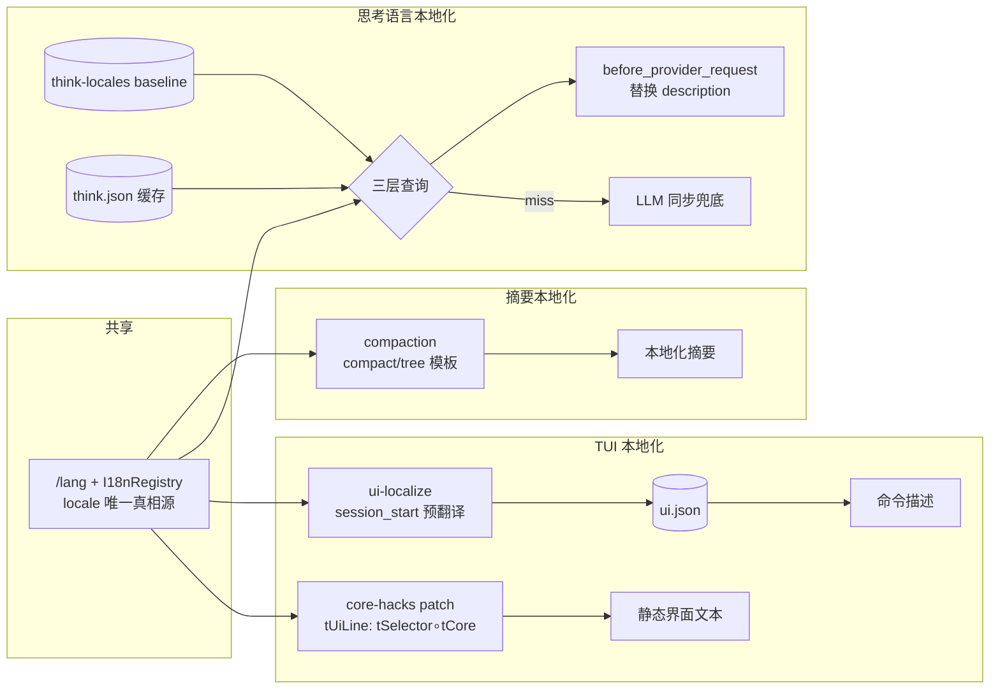

# 三条线机制与数据流

> A/B/C 各线的内部机制。数据资产键集契约见 [12-词典包与词包契约](../规格/词典包与词包契约.md)，总体结构见 [10-系统架构](./系统架构.md)。

## A 线：TUI 本地化

两类消费者、两条路径：

**静态界面文本（core-hacks patch）**：`installCoreHacks()` 对 Pi 内部模块做运行时 patch。核心是 `tUiLine` 管道：`tSelector(tCore(line))` → zh-CN 后处理 → 宽度保护。三类替换机制：

1. **exact 整表**：键值对精确/子串替换，长 key 优先。枚举值（`fullscreen`、`all`、`true` 等）在 `EXACT_WHOLE_LINE_ONLY_KEYS` 白名单里，只允许整行匹配，防止子串替换污染长句。
2. **组件级 patch**：`SettingsSelectorComponent`、`ModelSelectorComponent`、登录对话框等，patch 其 render 或数据方法。设置行的 `currentValue` 在 `renderMainList` 渲染期间临时翻译、渲染后还原（存储值保持英文原文，`activateItem` 的 `values.indexOf` 循环和子菜单预选依赖原始值）；值翻译不走行级宽度保护——上游渲染自行截断，提前限宽会把 `all → 全部` 截成 `全…`。
3. **zh-TW legacy 表**：旧版逐条 replaceAll + 动态正则（如 "73 calls, 73 results"），先跑 legacy 再补 pack。

**动态命令描述（runtime UI 本地化）**：`src/ui-localize/` 在 `session_start` 异步扫描 `pi.getCommands()`，把扩展/技能/提示词命令描述翻进 `ui.json`；`tSlashDesc` 按 name 查 `pi.slash.<name>.description` bundle key，未命中再查 runtime 缓存，最后回退。`[t]`/`[u]` 来源标签前缀在翻译后保留。

## B 线：思考语言本地化

`src/think/`。三层翻译源，顺序固定：

1. **预制 baseline**（`src/think-locales/*.json`，随包发布，12 语言）：命中零等待。
2. **翻译缓存**（`~/.pi/agent/state/pi-di18n/think.json`）：每条带英文原文，原文不一致即过期重翻。
3. **LLM 兜底**：session 当前模型同步翻译，失败回退英文，不阻塞。

替换只动 `description` 散文，不碰字段名/type/enum/值（ADR 0002）。触发时机：

- `session_start`：`prefetchOnSessionStart` 异步预翻译缺失项（fire-and-forget，不阻塞）。
- `before_provider_request`：`applyOnProviderRequest` 逐条替换 payload.tools；缓存 miss 同步兜底，与预翻译共享 in-flight 去重。

开关语义：磁盘 `enabled` 是全局默认（新会话初始值）；`/lang think on|off` 只改本会话内存；缓存落盘时 `enabled` 写磁盘全局默认，不写会话运行时值（2026-11-14 毒化修复）。语言不独立持有，跟随 `/lang` 的 locale。

## C 线：摘要本地化

`src/compaction/`。接管 `session_before_compact` / `session_before_tree`，用本地化模板生成分支/压缩摘要。要点：

- locale 从 `i18n.getLocale()` 传入，不自建检测。
- 默认跟随会话模型，`compaction.json` 可 override；鉴权走 Pi 会话级 resolver；每次摘要独立 routing session 并禁用不可复用的 prompt-cache 写入。
- 瞬态错误有界指数退避，确定性错误不重试；最终失败返回 `cancel: true`，阻止 Pi core 用会话模型再发第二套摘要请求。
- 大 payload（>512 KiB 媒体）推进 `firstKeptEntryId` 到安全 user 边界，原始 JSONL 不删除。

## 数据流图

